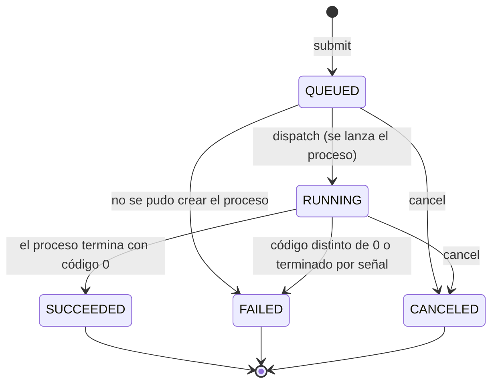

# Modelo de estados actual del Job

> **Alcance:** Hito 2 (núcleo local). Describe lo que implementa el código en `src/domain/job.hpp`, `src/domain/job.cpp` y `src/domain/job_manager.cpp`.
> **Requisitos relacionados:** RF-06, RF-07, RF-10, RF-26, RNF-27.

## 1. Estados

| Estado | Significado | Tipo |
|---|---|---|
| `QUEUED` | El Job fue aceptado y registrado, y espera un cupo o el siguiente arranque del servidor. | Inicial |
| `RUNNING` | El Job tiene un proceso hijo en ejecución (se guarda su PID). | Activo |
| `SUCCEEDED` | El proceso terminó con código de salida 0 y sin señal. | Terminal |
| `FAILED` | El proceso terminó con código distinto de 0 o por una señal. | Terminal |
| `CANCELED` | Se solicitó la cancelación del Job. | Terminal |

## 2. Diagrama de transiciones

## 3. Transiciones válidas

La función `is_valid_transition()` (`job.cpp`) es la única fuente de verdad. Cualquier otra combinación lanza `std::logic_error` desde `Job::transition_to()`.

| Desde | Hacia | Quién la dispara | Dónde en el código |
|---|---|---|---|
| (nuevo) | `QUEUED` | `submit` | `IJobStore::create` (`SqliteJobStore` en el servidor) |
| `QUEUED` | `RUNNING` | `JobManager::dispatch` tras lanzar el proceso | `job_manager.cpp` (`dispatch`) |
| `QUEUED` | `CANCELED` | `JobManager::cancel` | `job_manager.cpp` (`cancel`) |
| `QUEUED` | `FAILED` | Fallo al crear el proceso (`fork` o `pipe`) | `job_manager.cpp` (`on_launch_failed`) |
| `RUNNING` | `SUCCEEDED` | Terminación del proceso con código 0 y sin señal | `job_manager.cpp` (`on_child_exit`) |
| `RUNNING` | `FAILED` | Terminación con código distinto de 0 o por señal | `job_manager.cpp` (`on_child_exit`) |
| `RUNNING` | `CANCELED` | `JobManager::cancel` (envía `SIGTERM` al grupo de procesos) | `job_manager.cpp` (`cancel`) |

## 4. Reglas

1. **Los estados terminales no tienen salida.** `SUCCEEDED`, `FAILED` y `CANCELED` no admiten ninguna transición, por lo que no son posibles las regresiones (RNF-27).
2. **La cancelación es idempotente.** Cancelar un Job que ya está en un estado terminal devuelve éxito y no cambia nada. Cancelar un Job desconocido devuelve error (RF-10, RF-26).
3. **Un Job cancelado conserva `CANCELED`.** Si el proceso termina después de la cancelación, `on_child_exit` ignora el evento y no cambia el estado.
4. **Un solo hilo serializa los cambios.** El estado solo cambia dentro del event loop (ADR-003), por lo que dos cancelaciones simultáneas sobre el mismo Job producen un resultado coherente.

## 5. Datos que se registran con el estado (RF-07)

| Campo | Se llena cuando |
|---|---|
| `received_at` | Se crea el Job. |
| `started_at` | Pasa a `RUNNING`. |
| `finished_at` | Pasa a un estado terminal. |
| `pid` | Pasa a `RUNNING`. |
| `pid_start_time`, `boot_id` | Pasa a `RUNNING`; identifican el proceso para recuperación tras una caída. |
| `exit_code` | El proceso termina por sí mismo (`SUCCEEDED` o `FAILED`). |
| `exit_signal` | El proceso termina por una señal antes de que el Job sea cancelado. No se actualiza para Jobs que ya están `CANCELED`. |
| `diagnostic` | Se interrumpe por reinicio o se cancela durante el cierre controlado. |

## 6. Comportamiento actual y limitaciones

- **`QUEUED` es observable.** Los Jobs sin cupo permanecen en la cola FIFO, con un máximo predeterminado de 10 en espera; al llenarse, el servidor rechaza la solicitud sin crear el Job.
- **Persistencia y recuperación.** SQLite conserva el historial. Al arrancar, los Jobs `QUEUED` se reencolan por `received_at`; los Jobs `RUNNING` se marcan `FAILED` con diagnóstico de interrupción, después de intentar terminar procesos supervivientes verificados.
- **Cancelación en ejecución.** Se marca `CANCELED` al solicitarla, envía `SIGTERM` y escala a `SIGKILL` tras 5 segundos si el proceso líder sigue registrado. Si el líder termina antes, se cancela el temporizador; actualmente no se verifica entonces si algún descendiente ignoró `SIGTERM`.
- **Diagnóstico en cierre.** Los Jobs en ejecución cancelados por cierre controlado conservan `CANCELED` y reciben el diagnóstico `cancelado por cierre del servicio`.
- **Un comando inexistente termina en `FAILED` con código 127.** El Job se acepta y el error aparece en el `exec` del proceso hijo. Es una decisión de diseño, no un error del servidor.
- **Falla al crear el proceso.** El manejo de una falla de `fork` o `pipe` después de crear el registro y antes de pasar a `RUNNING` sigue pendiente; no existe una transición `QUEUED → FAILED` en el modelo actual (ver [ADR-003](../decisions/ADR-003-Concurrencia.md)).

## 7. Verificación

- **TC-003 (Estados y tiempos):** cubre RF-06 y RF-07; las pruebas unitarias revisan transiciones permitidas y terminales.
- **Pruebas Catch2 con etiqueta `[TC-005]`:** `tests/test_job_manager.cpp` cubre cancelación y su estado observable.
- **TC-009 (Cierre sin procesos huérfanos):** verifica cierre controlado, espera y escalamiento a `SIGKILL`.
- **Pruebas Catch2 con etiqueta `[TC-007]`:** `tests/test_recovery.cpp` y `tests/test_sqlite_job_store.cpp` cubren restauración, orden FIFO y persistencia de datos.

El estado y la evidencia de los casos están en [Verificación](../../verif/README.md).
